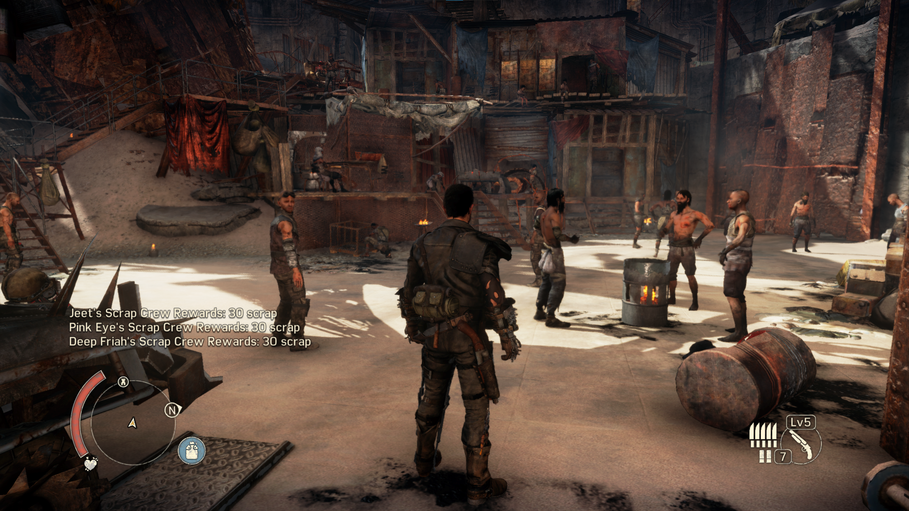

# Mad Max (2015): local Scrap Crew

A drop-in `winhttp.dll` that restores Scrap Crew income in Mad Max (2015, PC) now that the
publisher's online services are gone. It adds files to the game folder and changes none.
It needs no server, certificate or network change. Tried with the Steam version on Windows and on
a Steam Deck.



## What to expect

- Start the game and load a save: Scrap Crew scrap arrives if more than 10 minutes have passed
  since the last reward. The first time with the mod, it arrives right away.
- The challenges "A Penny Saved" and "Dividend" progress again.
- The online features in the main menu show as locked. This is expected: the mod restores only
  the Scrap Crew.

## How much scrap

The amounts are the game's own. The mod only tells the game how long ago the last reward was,
as your computer's clock measures it; the game's unchanged code decides what that is worth.

## How it works

The game asks two online hosts about the Scrap Crew reward. The DLL answers those requests
itself, inside the game process, through a listener reachable only from your own computer. The
time of the last reward is kept in a file in the game folder.

The game therefore no longer contacts those two hosts. Without the mod it still sends your
SteamID and a Steam ticket to `cls.psn.turbine.com`. Other connections are passed to Windows (or
Proton) unchanged.

## Install

Take `winhttp.dll` from the release download, or [build it](#build).

The game folder is the one holding `MadMax.exe` (in Steam: right-click the game, Manage, Browse
local files). If it already has a `winhttp.dll`, that file belongs to another mod: do not
overwrite it. The two cannot be used together.

### Windows

1. Copy `winhttp.dll` into the game folder.
2. Start the game as usual.

### Steam Deck and Linux (Proton)

Tried on a Steam Deck with Proton 11.0-3. Other Linux systems have not been tried.

The mod works only with the Windows version of the game run through Proton. Mad Max also has a
native Linux version, which cannot load it.

1. Check that the game folder holds `MadMax.exe` (on the Deck, in Desktop Mode). If it does not,
   open the game's Properties, force the use of a Proton version under Compatibility, and let
   Steam download the Windows files.
2. Copy `winhttp.dll` into the game folder.
3. In the game's Properties, set the launch options to:

   ```
   WINEDLLOVERRIDES="winhttp=n,b" %command%
   ```

   Without this, Proton ignores the file. Do not shorten it to `winhttp=n`: the mod needs
   Proton's own `winhttp.dll` too. If you already have launch options, put the
   `WINEDLLOVERRIDES=...` part in front of them and keep a single `%command%`.
4. Start the game.

If you set up [madmax-2015-offline](https://github.com/3ek/madmax-2015-offline) before, remove
its launch option and run its uninstall scripts: this mod needs none of it.

## Uninstall

1. Delete from the game folder: `winhttp.dll`, `madmax_scrapcrew.log` and
   `madmax_scrapcrew.dat` (and `madmax_scrapcrew.dat.new`, if there is one).
2. With Proton, remove the `WINEDLLOVERRIDES=...` part from the launch options.

Scrap already received stays in your save. Steam's "Verify integrity of game files" does not
remove the mod.

## Files the mod writes

Both go next to the DLL, or into `%TEMP%` if that folder cannot be written to.

- `madmax_scrapcrew.dat`, kept between launches: your SteamID, Steam display name, installed DLC
  names and the time of the last reward. Do not share it. Deleting it makes the next reward count
  as the first.
- `madmax_scrapcrew.log`, overwritten at each launch: startup, one line per online call (path,
  sizes and result), reward times and errors. It holds no request or response contents.

Each computer has its own `.dat`, so each gives a first reward and then counts on its own. To
keep a single count when playing on two computers, copy the file from the one used last to the
other, with the game closed.

## If something goes wrong

- No `madmax_scrapcrew.log` after starting the game, neither in the game folder nor in `%TEMP%`:
  the DLL was not loaded. Check that it is
  next to `MadMax.exe` and, with Proton, check the launch options.
- With Proton, a proxy set in `http_proxy` or in the game's Proton prefix is expected to keep the
  mod from working (not tried): remove it for this game.
- The game does not start: delete `winhttp.dll`.
- To report a problem, attach `madmax_scrapcrew.log`.

## Build

Needs `x86_64-w64-mingw32-gcc`. The tests also need `gcc` and WSL, to run a Windows program.

```sh
./build.sh          # build/winhttp.dll
./build.sh trace    # also build/trace/winhttp.dll
./build.sh test     # build both and test
```

The trace build is for investigating: its log also lists every WinHTTP call the game makes, with
host names, request paths and headers, but no contents, query strings, cookies or authorization
headers.

## Credits

[madmax-2015-offline](https://github.com/3ek/madmax-2015-offline) by its contributors
(GPL-3.0-or-later) is a local server emulator that restores the same feature, and the reason
this mod is possible. [What this project takes from it](docs/credits.md).

## Documentation

[docs/](docs/README.md): how the game's online calls and the DLL work.

## Licence

[GPL-3.0-or-later](LICENSE).
